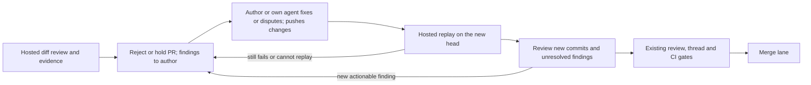

# Hosted analysis, review changes by the author

Status: proposal; no runtime changes. Reviewed against `agent-labs-dev/mergeloop` main at
[`2fddead07867e30181b006c66fc9f10614973040`](https://github.com/agent-labs-dev/mergeloop/commit/2fddead07867e30181b006c66fc9f10614973040),
2026-11-07. This baseline predates the review-policy decision below. Source links refer to its modules;
proposed names and fields are explicitly marked.

## Decision

Keep MergeLoop's sandboxed review, security analysis, experiments, evidence replay and merge gates hosted.
Remove auto-fix for review findings in every execution mode. A finding that requires a code change
rejects or holds the PR for its author to pick back up; the author's agent may help, but MergeLoop
does not generate and publish a corrective commit first. Auto-fix is limited to red CI, controlled
by `fix_ci`; review findings neither use that budget nor start its fixer.

Review the PR's diff on the first round. On later rounds, review the diff/new commits since the last
reviewed head, with unresolved findings and author replies as context, instead of re-reviewing the
whole PR. Read surrounding code and run experiments where needed to judge those changes.

In the stricter ownership split below, hand CI edits, conflict resolution and publication to the
user's own agent too. Show hosted analysis and author action together on the existing PR screen,
with the next action and the head each is working on. Every hosted-originated change is a proposal
the owner can see and accept or reject through their agent. Only that agent applies accepted
changes; show each proposal's target commit alongside the current head. A review finding is a
request to its author, not an automatic patch proposal the author must accept.

Extend the existing execution setting with an opt-in third mode, proposed as
`agent.runs: hosted-review`. Keep the review, CI and conflict ownership of `hosted` and `local`,
subject to the global removal of review auto-fix. The current `local` setting moves the review to
the author's agent too, so switching to it does not meet the hosted-analysis request.

Ship the read-only ownership and next-action view first. The polling loop already exists; the execution
split and independent validation of an author's fix are the larger change.

## Feedback and its limits

The request's excerpt of Furqan's third bullet ends at “easy to m...”. That fragment alone establishes
no additional requirement. Reading the full #mergepatrol message recovered the actual continuation:
he describes his agent looping, pulling the latest state and checking whether it needs to do something.
The following bullet asks to use MergeLoop directly instead of having his agent search PR comments.
This is recovered source text, not a completion inferred from the fragment.

Source: Furqan's message at 2026-11-06 04:03 UTC, message
`evt_06aed519304277b38000cdaeda6ccdc9`, in channel `chan_06ae376bbb427a7680006e6808afe8d4`.
The proposal addresses that confirmed polling request alongside the interface and execution split;
it infers no other meaning for the truncated text.

Furqan's further feedback at 2026-11-06 05:06 UTC was “i can't really control what it puts in.”
That establishes the owner-control requirement below. The screenshot is unavailable; no claim
about its contents or which writer produced them is needed or inferred.

Jonas's decision in #mergepatrol on 2026-11-07, agreed by Furqan, supersedes the earlier review-fix
framing: auto-fix remains only for red CI; code-change findings reject or hold the PR for the author;
later reviews cover the diff/new commits rather than the whole PR again. The optional ownership
split adds owner control without preserving a hosted review fixer in another mode.

## Implementation baseline before the decision

The Rust crates retain their `mergepatrol` names. Hosted execution means the service's job sandbox,
not the user's agent process. `LocalExecutor` in [executor](../crates/executor/src/lib.rs) is a development
subprocess implementation; it is distinct from `agent.runs: local`.

| Step | Baseline owner and behavior | Agreed behavior (`hosted-review` where noted) |
| --- | --- | --- |
| Review scheduling and deep analysis | [review.rs](../crates/mergepatrol/src/review.rs), `review` / `run_review`, sends `Task::Review` through `job_spec` and the executor. [job.rs](../crates/mergepatrol/src/job.rs), `review`, invokes the resolver, parses findings and attaches code. [resolver](../crates/resolver/src/lib.rs), `review_prompt`, permits reading callers, tests, config and history, running tools and writing diagnostic tests; it covers bugs, security, data loss and broken contracts. | Remains hosted in `hosted` and `hosted-review`, including experiments and security analysis. First review covers the PR diff; later rounds cover new commits and unresolved findings. Diagnostic edits are disposable analysis, never a published fix. |
| Review finding handoff | `review::finish` can hold a PR before publishing its findings; `conclude` calls `fix_sent_back`. This calls `queue::fix_findings`, constructs `Task::FixReview`, then runs `fix_and_publish`. The sandbox's `job::fix` / `commit_fix` validates and commits edits. The orchestrator checks the bundle and publishes it, including restacking. | Remove this review-fix path in all modes. Make findings and evidence immediately readable, reject or hold the PR and return it to its author. No hidden fix attempt, fix-budget fallback or automatic corrective commit. |
| Failed CI and conflicts | [queue/prep.rs](../crates/mergepatrol/src/queue/prep.rs), `hold` / `job`, starts rebase or fix work off the lane. [queue.rs](../crates/mergepatrol/src/queue.rs), `run_job`, also has rebase, fixing and rechecking phases. [core/job.rs](../crates/core/src/job.rs) owns the job state machine. CI and review share `fix_ci`'s hosted fix budget; the documented default is three. | Reserve `fix_ci` and its budget for red CI alone in `hosted`. Conflict resolution remains a separate task. In `hosted-review`, reuse `AuthorRebase` and `AuthorFix` holds: the author's agent edits, tests and pushes, without consuming hosted CI attempts. |
| Verify-command selection | `job::checks_for` prefers configured `spec.verify`. Otherwise `checks_from_ci` reads sorted files in `.github/workflows` at the checked-out PR head. [core/ci.rs](../crates/core/src/ci.rs), `verify_from_ci`, keeps at most five distinct usable commands from workflows containing `pull_request`; it handles working directories and skips unsupported or CI-dependent commands. There is no `crates/mergepatrol/src/ci.rs` on this baseline. | Keep one hosted derivation and send its result, source and head to the author's agent. Reuse `verify_from_ci`, also already used by `review::author_brief`; do not implement another workflow parser in a client. |
| Verify enforcement | [resolver](../crates/resolver/src/lib.rs) distinguishes `Verify::Configured`, `Ci` and `None`. `job::verify` runs only `spec.verify` after a resolution or fix. Workflow-derived commands inform the agent; they are not an additional automatic ejection gate. GitHub's required checks remain a separate gate. | Author runs the supplied commands locally. Hosted validation independently runs configured verify commands; workflow-derived suggestions retain their existing advisory role. |
| Finding evidence | `job::check_evidence` resets to the reviewed head for each change finding, applies only its named evidence files, runs the command and records the patch/output. `failed` excludes timeouts and exit 126/127. `unsafe_file` rejects paths outside the checkout and `.github` / `.mergepatrol`. [core/review.rs](../crates/core/src/review.rs), `shows_the_change` / `ReviewSettings::route`, requires failed evidence for a non-security author change; security may be supported by code alone. Confidence, human-only kinds and `needs_human` still apply. | Remains hosted, with the same security exception and routing. A local report that a command passed or failed cannot replace it. |
| Evidence after an author change | `job::apply_evidence` installs the original failing evidence before the hosted fixer; `evidence_passes` requires its commands to pass and its patches to remain intact. `commit_fix` also runs configured verify commands. `queue::check_fix_output` checks ancestry and protected paths before publishing a hosted fix. | Preserve independent hosted evidence replay on an author's resulting head without restoring a review fixer. Extract this validation from the removed review-fix path; red-CI fixing remains separate. |
| Gate and merge | [web/gate.rs](../crates/web/src/gate.rs), review status, required checks and thread resolution feed queue holds. `queue::run_job` rechecks the review and head before merging. [queue-flow.md](queue-flow.md) explains preparation, stacks and the single merge lane. | Remains hosted. Neither a progress report nor a local “done” grants approval, resolves a human decision or authorizes a merge. |

Two existing capabilities narrow the implementation considerably:

- [core/repo_config.rs](../crates/core/src/repo_config.rs), `Runs::{Hosted, Local}`, already selects execution
  ownership. With `Local`, prep leaves conflicts/check failures to the author, and `review::review` waits for
  an author-submitted review. `posted_review` trusts that agent's evidence claim without rerunning it.
  That legacy exception must not become the path used by the new hosted-review mode.
- [web/need.rs](../crates/web/src/need.rs), `next_need`, already returns `needs`, `id`, `layer`, `brief`,
  `then`, `exit_code` and `status`. It supports `after` and up to 50 seconds of long polling, with an
  internal three-second poll. [cli](../crates/cli/src/main.rs), `land`, calls it through MCP and waits
  through `wait` responses; it starts no agent. A user agent follows the returned brief, then polls again.

## Execution contract and implementation

### Hosted output is a proposal; the user's agent owns publication

In the opt-in `hosted-review` mode, enforce this boundary across code and PR content:

- Hosted jobs may read code, run analysis and experiments, write disposable diagnostic files,
  and persist findings, evidence, proposals and validation/gate state inside MergeLoop. They may
  not publish those files or generated content directly into the user's repository or PR.
- Every proposed change has a stable proposal ID and revision, repo/PR/layer, target `head_sha`,
  originating review ID where applicable, reason/evidence, and the exact diff or proposed text.
  This includes source, tests, docs/config, rebases/restacks, empty commits, PR titles/bodies,
  comments/replies, reviewer requests and thread resolutions. The owner can inspect the complete
  change and accept or reject it through their agent before any write to GitHub.
- Persist a typed decision/application state: `pending | accepted | rejected | stale | applied`.
  Acceptance authorizes the user's agent to apply that version through its own workflow; it
  never invokes a hosted publisher. Record the agent's resulting commit or GitHub operation
  separately and verify it before showing `applied`. Polling, a heartbeat or a lease is no consent.
- Rejection is recorded and leaves the repo/PR untouched. It does not clear an unresolved finding,
  authorize a merge, start a hosted fixer or reissue the same rejected proposal as new work.
  A revised proposal needs a new revision and a fresh decision. A moved target head makes an
  unapplied proposal stale; refresh its diff/text and request a new decision before application.
- The queue may prepare integration work in a disposable checkout. Any rebase, restack or other
  change to a user's branch still goes through their agent, even when deterministic. An explicitly
  owner-authorized final merge remains hosted behind the existing gates, using the content the
  agent applied; merge authorization cannot authorize additional generated content.

These publication guarantees belong to the proposed new mode; the review-policy change applies
to every mode. Preserve existing ownership settings except that review findings always go to the
author. Store proposal context once and project it through the existing review/need reads to both
the UI and the polling agent. Rejecting a suggested edit never clears the underlying review hold.

### One execution policy, applied at every dispatch

Add proposed `Runs::HostedReview` with an explicit serde name `hosted-review` in
[core/repo_config.rs](../crates/core/src/repo_config.rs). Add an exhaustive task-routing method on that
existing enum using `SpendTask`, rather than a second settings hierarchy:

| Mode | Review | Review findings requiring code | Red CI | Conflict resolution |
| --- | --- | --- | --- | --- |
| `hosted` | Hosted | Reject/hold for the author | Hosted auto-fix when enabled | Hosted |
| `local` | Author's agent | Reject/hold for the author | Author's agent | Author's agent, subject to the baseline prep-disabled exception |
| `hosted-review` (new) | Hosted | Reject/hold for the author | Author's agent | Author's agent |

Question answering currently runs hosted even with `local`; preserve that behavior. For the new mode,
questions about findings and security investigation stay hosted in MergeLoop. Queue preparation
and the final merge remain hosted within the boundary above; clean rebases, restacks, title
corrections and empty-commit workarounds require a proposal applied by the author's agent too.

Apply the policy to all of these existing seams:

- `review::review` selects the reviewer; `finish` must make findings immediately readable and
  reject or hold the PR for the author in every mode. Remove `hold_for_fix`, `fix_sent_back`,
  `queue::fix_findings` and `Task::FixReview` dispatch instead of retaining a mode-specific bypass.
  Keep `FixChecks` restricted to failed CI; a review finding cannot masquerade as a CI failure.
- `review::publish` / `post`, reviewer requests, queue comments and `retitle` must hand proposed PR
  writes to the user's agent in this mode. Guard branch publication (`publish_to_pr` and restack
  paths) as well as job dispatch; suppressing a fixer alone does not enforce this boundary.
- `queue::read_repo` currently uses one `hosted` boolean for review enablement and credential tasks.
  Determine credentials per task: this mode needs the hosted review key, not hosted fix/rebase keys.
  Explicit opt-in to hosted review must hold with a visible missing-key reason if that review cannot
  run, rather than silently skipping analysis through the default-review key shortcut.
- `prep::hold`, `Prep::takes_agent_work`, `queue::run_job`, `fix_and_publish` and
  `rebase_layers` must enforce author ownership in both prep and the lane. A conflict must stop
  before a resolver runs; a failed check must return an author hold before `Phase::Fixing` or a
  hosted retitle/recheck workaround. A stack's hold names the affected layer and keeps its place.
- Cover `MERGEPATROL_PREP=false` explicitly. Today prep returns early and the README documents
  hosted conflict resolution even with `local` in that configuration. For the new mode, ownership
  must be checked independently of prep: return the same author holds from the lane. Never silently
  fall back to a hosted fixer. On policy changes, cancel old corrective jobs and reject their results
  before publication; existing head/queue checks alone do not check execution-policy changes.
- Update the config writer/inheritance in `core/repo_config.rs`, `RepoSettingsView`'s explicit
  TypeScript union in [web/api.rs](../crates/web/src/api.rs), generated `ui/src/api` types and
  [RepoSettings.tsx](../ui/src/RepoSettings.tsx). Keep existing defaults. The relevant MCP settings
  tools are `get_repo_config`, `propose_repo_config`, `get_repo_defaults` and `set_repo_defaults`;
  they must round-trip the new value instead of dropping it.

Keep fork handling unchanged: main does not run its agent on fork PRs. This proposal does not grant
the author's agent any new GitHub or model credentials.

### Hand off a finding; verify the author's pushed result



This is the proposed flow. Do not clear a finding just because the client reports completion.

1. Add typed handoff context to `NeedView`: proposed `head_sha`, `review_id`, `proposals` and `verify` with
   `source: configured | ci | none`. Retain `id` / `after` / `wait` and the current need kinds.
   `proposals` carries the shared proposal context and decision/application state above; it is
   delivered through the existing `next_need` loop, not a separate agent or subscription.
   Scope finding identity by review ID and head: `f1` is numbered anew for each review.
   `get_agent_review` already returns the complete evidence patch, command and output.
   Fetch a single authoritative snapshot and recheck its head before handing it out; an outdated
   latest review must be labeled stale, not presented as work on the current head.
2. The author picks up the rejected or held PR, inspects the findings/evidence and decides how to
   fix or dispute them. Their own agent may edit, run checks, commit and push through the author's
   authorized workflow. A hosted suggestion remains optional; if used, show its exact content and
   target head, record owner acceptance and recheck its revision/head before application. Only the
   user's agent applies it. Accepting or rejecting a suggestion cannot clear a finding. The agent
   replies to findings it fixed or disputes; it does not use `answer_agent_review` to approve itself.
   The next webhook/tick discovers the new head, as with author pushes today.
3. Add proposed `Task::VerifyFix { findings }` to [executor/protocol.rs](../crates/executor/src/protocol.rs)
   and dispatch it in `job.rs`. It returns validation data, never a bundle or fix commit;
   `Task::returns_code` must be false. Extract the evidence replay helpers within the job domain
   so red-CI fixing and author-change validation can reuse them without a review fixer. Update
   protocol output allowlists/remote transport if a separate validation result file is introduced.
4. Replay the saved hosted evidence against the new head in a disposable checkout. If its original
   patch is already intact, use it; otherwise apply that original patch. Use
   [Git::holds / apply](../crates/git/src/lib.rs), and check patch integrity after commands run.
   A patch conflict or changed diagnostic test is an explicit replay failure needing refreshed
   hosted evidence or a human decision, never an inferred pass. Configure/install dependencies
   through the command just as today's evidence replay does. Run configured verify commands too.
5. Persist validation against `(review_id, reviewed_head, candidate_head)` in
   [store/review.rs](../crates/store/src/review.rs) with a migration. Stale results cannot clear a
   different head. Preserve failure output; timeouts/tool absence mean validation incomplete.
   `review::earlier` and the resolver already carry prior findings and replies into the next review;
   attach this independent validation there. Security findings without runnable evidence still
   require the hosted reviewer to examine the correction. Human asks retain their existing gate.
6. Carry the last reviewed head and candidate head through review scheduling and the prompt.
   The first round reviews the PR diff; later rounds review only the diff/new commits since that
   reviewed head plus unresolved findings and replies. Keep prior review coverage instead of
   re-reviewing unchanged work. A rewritten history or unavailable baseline requires an explicit
   new comparison baseline shown in the review; never claim incremental coverage without one.

The sandbox keeps its existing read-only fetch token, revocation and model proxy boundaries.
The author agent never receives `JobSpec`'s service access or a hosted job link. The new validation
job may write temporary diagnostic files but must not publish any of them.

## The “where my agent is” view

Put one card in [QueueGate](../ui/src/Queue.tsx), already shared by Queue and You above
[PullDetail](../ui/src/PullDetail.tsx). Keep [AgentReview](../ui/src/AgentReview.tsx)'s findings and
the existing activity tab as the detail behind it. Illustrative content, not a production screenshot:

```text
PR #N · head <current head> · stage Review

MergeLoop     Hosted review finished on <reviewed head> · 2 findings need changes
Author        PR held: fix or dispute the findings · targets <reviewed head>
Proposal P1   Optional suggestion · targets <proposal head> · pending owner decision
Your agent    Action needed: inspect findings and evidence · connection/activity unknown
GitHub CI     Waiting for a new push · current checks linked below

Next action   Pick up review findings   Copy agent command
Activity      Last queue event and time
```

Once progress reporting exists, the agent row can instead say “Jonas's agent · fixing · last
reported 20s ago”, or “No recent report”. Agent name and phase are reported status, not proof
that a process is alive. Do not label an author hold “your agent is running”.

| Information the view needs | Existing source | Gap / proposed addition |
| --- | --- | --- |
| Queue stage, active lane step, holds and stack layer | `EntryView` in `web/api.rs`; `PullStateView` / `HoldReasonView` in [web/v1.rs](../crates/web/src/v1.rs). `list_queue`, `pull_status` and `next_need` expose these. | Project ownership from the typed policy and hold, not from parsing English event messages. A `prep_*` hold means hosted work; an `author_*` hold means work required from the user's agent. `review_changes` always returns responsibility to the author. |
| Review head, findings, cleared/withdrawn status and last update | `ReviewRecord` in `store/review.rs`, projected as `AgentReviewView` / `ReviewBriefView` in [web/review.rs](../crates/web/src/review.rs). | Show reviewed head beside current head. Add review ID and effective execution mode to the shared response where needed. `agent_fixed` means the queue's agent fixed it; it does not identify the user's agent. |
| Each proposed change and its owner decision | New shared proposal context on the existing review/need projections. | Show proposal ID/revision, exact diff/text, target commit, current commit, pending/accepted/rejected/stale/applied state and verified application result. Label stale proposals explicitly; never imply acceptance for a different head. |
| What to do next | `NeedView` and its `brief` / `then`, served by `next_need`. | First slice reads with `wait: 0` for the selected PR. Show action plus connection unknown; do not launch an agent or queue a PR merely to display it. |
| Last activity and coarse hosted work | Stored queue events via `list_events`; `QueueActivity` already polls every three seconds. Review `pending` / `running` is stored. | Job `JobEvent`s are accumulated in `job.rs` and recorded by `review::run_job` after executor completion; they are not a live tool stream. A running review can be waiting for a sandbox slot. Show coarse state honestly; live hosted substeps need new streaming/persistence. |
| Actual user-agent acknowledgement, phase and freshness | Absent. `ReviewRecord.claim` and database `claimed_at` fence hosted review workers; prep claims live in memory. Database `fixing` tracks an internal hosted review fix and is not a user-agent presence field. | Later add a durable agent-work lease and heartbeat, scoped to installation/repo/PR/layer/head. Do not reuse hosted worker claims. |

The first card needs no presence database and promises only ownership and the next action. A full
live view does require the last row's new state. Reuse the same server projection for UI and MCP;
do not create a second client-side queue state machine.

## MCP contract at `https://mergeloop.ai/mcp`

[routes.rs](../crates/web/src/routes.rs) is the single route/tool registry; [mcp.rs](../crates/web/src/mcp.rs)
calls those API handlers as the authenticated caller. MCP currently answers POSTs as JSON, has no
sessions or server-sent events, and GET returns 405. Use `next_need`'s existing long poll; no new
subscription transport is needed for Furqan's polling request.

| Surface | Concrete change |
| --- | --- |
| Existing reads: `list_queue`, `pull_status`, `get_agent_review`, `next_need`, `list_events`, `get_pull` | Add the ownership/head context through their canonical projections, keeping existing fields compatible. `get_pull` already provides current head, checks and open-thread summaries. First UI slice uses these reads only. |
| Existing `next_need` loop | Continue `next_need({repo, number, after: id, wait: 50})`; `threads` returns findings/evidence and an author hold, never an auto-fix request. Optional proposals require an owner decision before application. Keep `fix_checks` specific to red CI and preserve `conflict`, then poll again. Proposal revisions and decisions update the authoritative need; rejected proposals are not repeatedly offered as new work. `NeedKind` serializes snake_case. `id` is a hash of need/hold/latest event, not a proposal ID, acceptance or proof the agent took work. Progress events must not mint endless new work from heartbeats. |
| Proposed decision tool, with the execution split | Register `respond_to_agent_proposal` with proposal ID/revision, target head and typed `accept` / `reject`. Reuse repo authorization, persist the caller and decision idempotently, and reject stale revisions/heads. It records consent only; all repository and PR writes are applied by the user's agent. This does not wait for the later progress/lease tools. |
| Existing `post_review` | Remains the legacy all-local review submission. New mode uses hosted findings and must never accept a local assertion through `posted_review` as hosted evidence. `ask_agent_about_review` remains the way to dispute a hosted finding; human `answer_agent_review` retains its existing role. |
| Proposed progress tools, after the split | Register `claim_agent_work`, `report_agent_work` and `release_agent_work` under a PR's `/api/w/{id}/repos/{owner}/{name}/pulls/{number}/agent-work` routes. Claims return an opaque fenced lease; reports name its head, work generation and a typed phase (`fixing`, `verifying`, `pushing`, `blocked`). Use a client operation ID for retry idempotency, monotonic fencing and lease expiry. Resolve caller identity server-side; a display name/session label is descriptive only. |
| Direct thread work, a follow-up | Today `need::THREADS` still tells the agent to list/reply/resolve threads with `gh` GraphQL. `get_pull`'s open-thread summaries lack thread IDs/full replies. Extend [github/detail.rs](../crates/github/src/detail.rs) and the projection, then add registered read/reply/resolve tools backed by existing GitHub adapters, scoped to the requested PR. Update the brief to use those tools. This closes the remaining PR-comment scraping gap without building another queue controller. |

For new writes, reuse [auth.rs](../crates/web/src/auth.rs)'s `Caller::repo` and
`caller.github_token` conventions. Require repo write access to claim/report fixing work. A lease
is not a GitHub credential and cannot authorize other repos, approve findings or request a merge.
Invalidate it on a new head, dequeue, retarget, stack reshape or mode change; expired reports cannot
revive it. The proposal boundary applies even before leases exist; a missing or expired lease
never permits hosted publication in `hosted-review`. Reconnect reads authoritative head/work
before reclaiming. A push is verified on GitHub before being shown
as pushed, and still needs hosted validation and normal gates. Lease expiry never starts a hosted fixer.

Implement lease storage in `crates/store` with a migration and typed models in `crates/core`;
it spans CI, conflict and review work, so it cannot be represented by the review row's worker claim.
The CLI remains a thin client of these tools, reporting only what it observes; the agent integration
must report its editing phase because the CLI cannot observe the parent agent. Register every new
API route with `tool!`, update descriptions and the README tool table, and regenerate `ui/src/api`
under the repository's existing API/MCP parity checks.

## Order and acceptance

| Order | Slice | Why / completion criterion |
| --- | --- | --- |
| Already available | Confirmed third bullet: agent polls for work | `next_need` and `mergeloop` already implement it. Show an example using the existing skill/CLI; no daemon or new transport to land. This is the smallest ask to satisfy. |
| First new change | Read-only ownership and next-action card | Extend the existing Queue/You PR gate with hosted/your-agent/CI rows, head freshness, the returned brief and a copyable command. Use existing read routes, plus an additive shared policy/head projection if needed. Render each proposal's target commit and decision state when proposals arrive with the split; do not invent proposals for legacy output. Show missing activity as unknown. No execution-policy or gate change. |
| Independent policy change | Remove review auto-fix and make later reviews incremental | In every mode, findings reject/hold for the author immediately; only red CI can auto-fix. Review the first PR diff, then new commits plus unresolved findings. Preserve evidence, security/human gates and independent replay without a corrective publisher. This is not conditional on the optional split. |
| Second | Opt-in `hosted-review` execution split, owner decisions and author-change validation | Route every hosted-originated repo/PR change through an owner-visible proposal and the user's agent; retain deep hosted diff review, configured checks, immutable evidence replay and head checks. Ship proposal storage/decisions, publication guards and validation together. This mode also hands CI fixes and conflicts to the author's agent; it never reinstates review auto-fix. |
| Third implementation slice | Acknowledgement/progress and direct thread tools | Add fenced leases and freshness reporting for a true live agent view, then remove the brief's dependence on `gh` thread queries. This is an implementation sequence, not an invented third feedback request. |

Before shipping the first slice, inspect the existing UI in both execution modes and show pending
review, author action, human ask, new/stale head, CI wait, stack layer, disconnected/unknown and
merged/ejected states. Do not equate a green CI badge with completed hosted review.

For the split, extend existing queue-loop scenarios in
[getting_ready.rs](../crates/mergepatrol/src/queue/loop_tests/getting_ready.rs), review-store cases and
[job tests](../crates/mergepatrol/tests/job.rs) at their stable seams. Prove these behaviors:

- A hosted review can inspect code/run a failing reproducer; its actionable finding rejects or
  holds the PR for the author immediately, in every mode, including in the lane and with prep
  disabled. It produces no `FixReview` and cannot dispatch `FixChecks`. A genuinely red CI check
  may still dispatch `FixChecks` under `fix_ci` in `hosted`; the stricter new mode returns it to
  the author. Conflicts, title failures and stacks follow their selected ownership policy.
- Every hosted-originated repo/PR change is visible with its exact content and target commit before
  acceptance. Pending, rejected and stale proposals cause no GitHub content writes, including
  comments, retitles and clean rebases. Acceptance alone also causes no hosted publication;
  only the user's agent applies it. UI and `next_need` show the same proposal, head and decision.
- An author push with a real fix passes the original hosted evidence and receives a diff-scoped review;
  a still-failing command, weakened diagnostic test, replay conflict or unavailable tool cannot
  silently clear it. Later rounds review new commits and unresolved findings without repeating
  the whole PR review. Preserve security and human-decision exceptions.
- A moved head, changed mode or removed queue label prevents an old job/lease/validation result
  from publishing or clearing anything. Existing `hosted` and `local` retain their ownership settings,
  except that neither may auto-fix review findings and both use the incremental review contract.
- API and MCP present the same next action. A heartbeat does not count as completed work or
  continuously reissue an already claimed task. Expiry displays no recent report and keeps author
  ownership; no background hosted fixer takes over.

This PR is a design only. Implementation slices need their own user-facing changelog entries and
validation. Keep this proposal open and unqueued; Jonas decides when it enters the merge queue.
