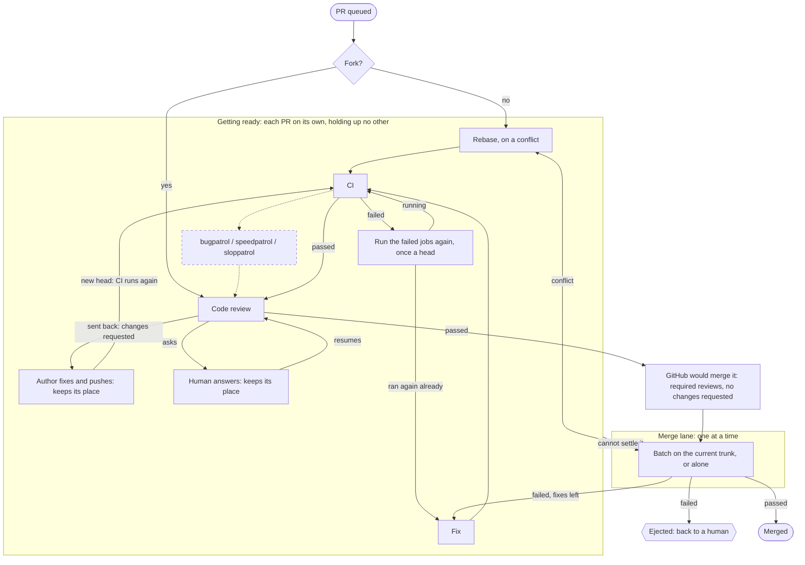

# How a PR moves through the queue

A PR gets ready on its own, and a stack gets ready as one, so here a stack reads as a PR. Only the merge lane runs one at a time, so no PR's CI or agent holds up another. `MERGEPATROL_PREP=false` runs all of it in the lane instead.

Dashed is planned, and not built.

- **Rebase** runs only on a conflict with the trunk. A PR that keeps up with the trunk by merging, or whose rebase conflicts while a merge does not, has the trunk merged into it instead, unless the repo merges by rebasing. A rebase that runs out of time merges instead, and is never the PR's failure: it runs again, as any job does on an error outside the PR. A batch merges PRs as they are. A PR alone is rebased in the lane, unless GitHub can merge it as it is: not a stack, no conflict, a trunk that is not strict, checks passed on its head, and not a suspect of a failed batch.
- **A failed GitHub Actions job** runs again once on each head before a fix, or before the PR is ejected with no fixes left: a failure such as a dropped network request may pass. GitHub's `run_attempt` on the workflow run says whether it ran again already, so a restart runs it no second time. A check of another app, or a commit status, goes straight to the fix.
- **Fixes** are one budget for a PR or a stack, for its checks: `fix_ci.attempts`, 3 by default. They are counted from the `Fixed-by:` commits on top of the author's last commit, so a push from the author earns new ones.
- **A stack** rebases and publishes as one. A layer may merge only while no layer below it was rebased. A conflict on any layer rebases it all. A fix goes on the lowest layer that failed, and the layers above it are rebased onto the fix.
- **A fork** goes straight to the lane. No agent runs on it, so there is nothing to rebase past a conflict or to fix. Waiting for its checks here would save the lane little: a fork never joins a batch, so unless it sits on the current trunk, the lane rebases it and runs its checks again.
- **A title check** can't be fixed by a commit. The agent proposes a title, MergeLoop sets it, and an empty commit runs the checks once more.
- **A fix or an agent's conflict resolution** needs a review of that change alone. A clean rebase keeps its approval.
- **What a review sends back** is the author's, never a fix of MergeLoop's: a review that requests changes on GitHub, with a thread per finding. Once the author resolves every thread, or a later review sends nothing back, MergeLoop dismisses that request. A human keeps what the review asks about.
- **Getting ready never ejects.** What it cannot settle goes on to the lane, whose job ejects as it always did: a failed job, no fixes left, or a check that never finishes.
- **The lane's job** rebases a PR that runs alone when it must, and waits for its checks. A skipped rebase means the PR merges on checks that ran before the trunk's newest commits, so nothing tested the two together. If GitHub refuses that merge, the job rebases after all. A conflict or a failed check goes back to getting ready, and the PR keeps its place while the next one goes on. Only forks and heads getting ready could not settle stay in the lane.

The code is `crates/mergepatrol/src/queue/prep.rs` for getting ready, `run_job` in `crates/mergepatrol/src/queue.rs` for the lane, and `crates/mergepatrol/src/review.rs` for the review.
